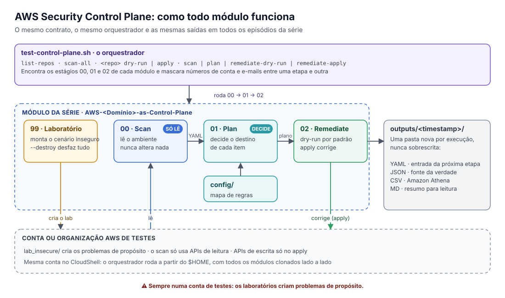

# AWS Security Control Plane Scripts

<p align="center">
  <a href="#-português">Português</a> •
  <a href="#-english">English</a>
</p>

<p align="center">
  
</p>

---

## 🇧🇷 Português

Quem trabalha com segurança na AWS já viu isso acontecer: cada problema ganha um script, cada script tem um jeito diferente de rodar, cada um grava a saída num lugar, e depois de alguns meses ninguém sabe mais qual script faz o quê, nem se dá para confiar nele.

Este repositório é o ponto de partida para resolver isso. Antes de escanear ou corrigir qualquer coisa, a gente combina **um jeito único de trabalhar**: o mesmo contrato de execução, as mesmas saídas e a mesma estrutura de pastas para todos os módulos da série.

> Este repositório é um **template do GitHub**. Cada episódio da série **AWS Security Control Plane** é um repositório próprio, criado a partir daqui, com toda a estrutura dentro dele.

### Por que um template?

Sem uma base comum, automação de segurança vira uma gaveta de scripts soltos. Com ela, cada módulo novo já nasce:

- com o **mesmo contrato** de execução, então quem aprendeu um sabe usar todos;
- com **saídas versionadas e auditáveis**, que nunca são sobrescritas;
- pronto para crescer: várias contas, pipelines de CI/CD, consultas no Amazon Athena e remediação como código.

### O contrato: scan, plan e remediate

Todo módulo da série funciona em três etapas, cada uma com uma responsabilidade só:

1. **Scan, que só olha.** Lê o ambiente e registra o que encontrou, com evidências. Nunca altera nada.
2. **Plan, que só decide.** Transforma o que o scan encontrou num plano de ação: o que será corrigido, o que fica para uma pessoa revisar e o que é exceção. É a sua prévia do impacto.
3. **Remediate, que age com cuidado.** Aplica o plano. Por padrão roda em *dry-run* e só mostra o que faria. Quando você roda em modo apply, ele corrige e registra o que foi planejado e o que foi aplicado.

> **A regra de ouro:** nada é corrigido sem querer. Toda execução pode (e deve) ser testada antes em dry-run.

### O laboratório e o script 99

Para testar um controle de segurança, você precisa de algo errado para ele encontrar. Por isso todo módulo tem um script `scripts/99_*`, que monta um laboratório com problemas de propósito (os recursos ficam em `lab_insecure/`). Com o mesmo script, usando `--destroy`, você desfaz tudo no final.

O ciclo completo de teste fica assim:

1. **Monte o cenário inseguro** com o script 99.
2. **Veja se o scan encontra** o problema e registra direito.
3. **Confira o plano**, para garantir que a correção proposta é a que você espera, sem mexer em nada.
4. **Corrija**: primeiro em dry-run, depois em apply, e rode o scan de novo para confirmar.

### O orquestrador: test-control-plane.sh

O `test-control-plane.sh` roda esse ciclo para você, em qualquer módulo da série. Ele procura os estágios `scripts/00_*` (scan), `01_*` (plan) e `02_*` (remediate), encontra o arquivo de regras em `config/`, e mascara números de conta e e-mails nas saídas antes de passar uma etapa para a outra.

```bash
./test-control-plane.sh list-repos                   # lista os módulos clonados no $HOME e confere se estão completos
./test-control-plane.sh scan-all                     # roda o scan de todos os módulos
./test-control-plane.sh <NOME_DO_REPO> dry-run       # scan, plan e remediate em dry-run
./test-control-plane.sh <NOME_DO_REPO> apply         # o mesmo, aplicando as correções
```

Também dá para rodar uma etapa só: `scan`, `plan`, `remediate-dry-run` ou `remediate-apply`.

### Mão na massa no AWS CloudShell

O AWS CloudShell é um terminal no navegador que já vem autenticado, com a AWS CLI e o Git instalados. É o jeito mais rápido de testar a série inteira.

**1. Clone os módulos da série no `$HOME`**

```bash
cd ~
for repo in $(gh repo list wagnermazevedo -L 100 --json name -q '.[].name' | grep -E '^AWS-.*Control-Plane'); do
    gh repo clone "wagnermazevedo/$repo"
done
```

(Se a GitHub CLI não estiver autenticada, rode `gh auth login` antes. Ou clone só o módulo que quiser com `git clone`.)

**2. Veja o que foi encontrado**

```bash
chmod +x ~/AWS-Security-Control-Plane-Scripts/test-control-plane.sh
~/AWS-Security-Control-Plane-Scripts/test-control-plane.sh list-repos
```

**3. Teste um módulo**

Cada módulo explica no próprio README como montar o laboratório dele. Por exemplo, para o Security Hub:

```bash
cd ~/AWS-Security-Hub-Control-Plane && pip3 install --user -r requirements.txt
python3 scripts/99_securityhub_lab_setup.py --region us-east-1
cd ~ && ~/AWS-Security-Control-Plane-Scripts/test-control-plane.sh AWS-Security-Hub-Control-Plane dry-run
```

⚠️ Use sempre uma conta (ou organização) de testes. Os laboratórios criam problemas de propósito.

### O que fica salvo em cada execução

Toda execução grava as saídas numa pasta nova, com data e hora no nome:

- **Nada é sobrescrito**, então o histórico fica íntegro.
- **Cada execução pode ser auditada sozinha.**
- **Tudo é legível por máquina**, o que facilita juntar resultados.

Os formatos:

- **YAML:** a entrada da etapa seguinte (scan para plan, plan para remediate).
- **JSON:** a fonte da verdade, com os dados completos.
- **CSV:** pronto para consultar no Amazon Athena.
- **Markdown:** um resumo para gente ler rápido.

Essas saídas se encaixam bem em Athena, gates de CI/CD, SIEM/SOAR e trilhas de auditoria.

### Como criar um módulo novo

1. Clique em **Use this template** aqui no GitHub.
2. Dê ao repositório o nome do domínio de segurança que ele vai cuidar.
3. Escreva a lógica do domínio em `scanner/`, `remediate/` e `lab_insecure/`, com os estágios `scripts/00`, `01`, `02` e o setup `scripts/99`.
4. Rode o `test-control-plane.sh` para validar de ponta a ponta.
5. Mantenha o contrato e o formato das saídas. É isso que faz todos os módulos conversarem entre si.

> Cada módulo é independente, mas todos se comportam do mesmo jeito.

### Os episódios da série

| Ep. | Repositório | Do que trata |
|---|---|---|
| 1 | [AWS Security Control Plane Scripts](https://github.com/wagnermazevedo/AWS-Security-Control-Plane-Scripts) | Este template: o contrato, as saídas e o orquestrador |
| 2 | [AWS Security Hub as Control Plane](https://github.com/wagnermazevedo/AWS-Security-Hub-Control-Plane) | Security Hub como fonte da verdade e de compliance: corrigir e fechar findings |
| 3 | [AWS Governance as Control Plane](https://github.com/wagnermazevedo/AWS-Governance-as-Control-Plane) | Organizations, SCPs e tag policies como código, com detecção de drift |
| 4 | AWS Data Protection as Control Plane *(em breve)* | KMS, criptografia, S3, Macie e Secrets Manager |
| 5 | AWS IAM & Identity as Control Plane *(em breve)* | Identidades, privilégios excessivos e CIEM |
| 6 | AWS Credentials & Exposure Control Plane *(em breve)* | Chaves vazadas e credenciais expostas: detectar, validar e responder |
| 7 | AWS Network & Perimeter as Control Plane *(em breve)* | Perímetro definido por software e tráfego de rede: VPCs, Security Groups, NACLs e portas expostas |
| 8 | AWS PaaS & Managed Services Control Plane *(em breve)* | Permissões em serviços gerenciados (CodeBuild, CodeDeploy, SageMaker, RDS) |
| 9 | AWS Logging & Detection as Control Plane *(em breve)* | CloudTrail, GuardDuty e detecção |
| 10 | AWS Incident Response as Control Plane *(em breve)* | Resposta a incidentes e remediação automática |
| 11 | AWS AI Agents & Shift-Left Control Plane *(em breve)* | Agentes de IA e segurança antes do deploy (final da temporada) |
| 12 | AWS Compute & Containers as Control Plane *(em breve, bônus)* | EC2, ECS, EKS e Lambda |

Todos seguem o mesmo contrato (scan, plan e remediate), usam o `test-control-plane.sh` para testar cada controle e gravam saídas versionadas. Você pode usar um módulo sozinho ou todos juntos.

### Onde fica cada coisa

Todo repositório criado a partir deste template tem esta estrutura:

```text
AWS-<Dominio>-as-Control-Plane/
├── test-control-plane.sh  # Orquestrador de testes
├── scripts/               # Estágios 00 (scan), 01 (plan), 02 (remediate) e 99 (laboratório)
├── config/                # O mapa de regras: o destino de cada controle
├── scanner/               # Detecção (só leitura)
├── remediate/             # Correções (sempre com dry-run)
├── lab_insecure/          # Recursos inseguros de propósito, para testar
├── tests/                 # Testes offline
├── reports/               # Relatórios consolidados
├── outputs/               # Saídas de cada execução (nunca sobrescritas)
├── lib/                   # Utilitários compartilhados (clientes AWS, gravadores de saída)
└── docs/                  # Documentação e diagramas
```

---

## 🇺🇸 English

Anyone who works with AWS security has seen this: every problem gets a script, every script runs differently, each one writes its output somewhere else, and a few months later nobody knows which script does what, or whether it can be trusted.

This repository is the starting point to fix that. Before scanning or fixing anything, we agree on **one way of working**: the same execution contract, the same outputs and the same folder structure for every module in the series.

> This is a **GitHub template**. Each episode of the **AWS Security Control Plane** series is its own repository, created from here.

### The contract: scan, plan and remediate

1. **Scan only looks.** It reads the environment and records what it found, with evidence. It never changes anything.
2. **Plan only decides.** It turns findings into an action plan: what gets fixed, what goes to a human, and what is an exception.
3. **Remediate acts carefully.** Dry-run by default. In apply mode it fixes things and records what was planned versus applied.

> **Golden rule:** nothing gets fixed by accident. Every run can (and should) be tried in dry-run first.

### The lab and the 99 script

Every module ships a `scripts/99_*` script that builds a lab with intentional problems (resources live in `lab_insecure/`) and tears it down with `--destroy`. The `test-control-plane.sh` orchestrator then runs the stages `00` (scan), `01` (plan) and `02` (remediate), masking account IDs and e-mails between stages:

```bash
./test-control-plane.sh list-repos
./test-control-plane.sh scan-all
./test-control-plane.sh <REPO_NAME> dry-run   # or: apply, scan, plan, remediate-dry-run, remediate-apply
```

⚠️ Always use a test account (or organization).

### Outputs

Every run writes to a new timestamped folder that is never overwritten: YAML (input to the next stage), JSON (source of truth), CSV (Amazon Athena) and Markdown (human summary).

### Creating a new module

Click **Use this template**, name the repository after its security domain, implement `scanner/`, `remediate/`, `lab_insecure/` and the `scripts/00`, `01`, `02` and `99` stages, and validate it end to end with `test-control-plane.sh`.

### The episodes

| Ep. | Repository | Topic |
|---|---|---|
| 1 | [AWS Security Control Plane Scripts](https://github.com/wagnermazevedo/AWS-Security-Control-Plane-Scripts) | This template: contract, outputs and orchestrator |
| 2 | [AWS Security Hub as Control Plane](https://github.com/wagnermazevedo/AWS-Security-Hub-Control-Plane) | Security Hub as the source of truth and compliance |
| 3 | [AWS Governance as Control Plane](https://github.com/wagnermazevedo/AWS-Governance-as-Control-Plane) | Organizations, SCPs and tag policies as code |
| 4 | AWS Data Protection as Control Plane *(coming soon)* | KMS, encryption, S3, Macie, Secrets Manager |
| 5 | AWS IAM & Identity as Control Plane *(coming soon)* | Identities, excessive privileges, CIEM |
| 6 | AWS Credentials & Exposure Control Plane *(coming soon)* | Leaked keys and exposed credentials |
| 7 | AWS Network & Perimeter as Control Plane *(coming soon)* | Software-defined perimeter and network traffic |
| 8 | AWS PaaS & Managed Services Control Plane *(coming soon)* | Managed service permissions |
| 9 | AWS Logging & Detection as Control Plane *(coming soon)* | CloudTrail, GuardDuty and detection |
| 10 | AWS Incident Response as Control Plane *(coming soon)* | Incident response and auto-remediation |
| 11 | AWS AI Agents & Shift-Left Control Plane *(coming soon)* | AI agents and shift-left security (season finale) |
| 12 | AWS Compute & Containers as Control Plane *(coming soon, bonus)* | EC2, ECS, EKS and Lambda |

### Repository structure

```text
AWS-<Domain>-as-Control-Plane/
├── test-control-plane.sh  # Test orchestrator
├── scripts/               # Stages 00 (scan), 01 (plan), 02 (remediate) and 99 (lab)
├── config/                # Rule map
├── scanner/               # Detection (read-only)
├── remediate/             # Fixes (always dry-run capable)
├── lab_insecure/          # Intentionally insecure resources for testing
├── tests/                 # Offline tests
├── reports/               # Consolidated reports
├── outputs/               # Versioned, immutable outputs
├── lib/                   # Shared utilities
└── docs/                  # Documentation and diagrams
```
